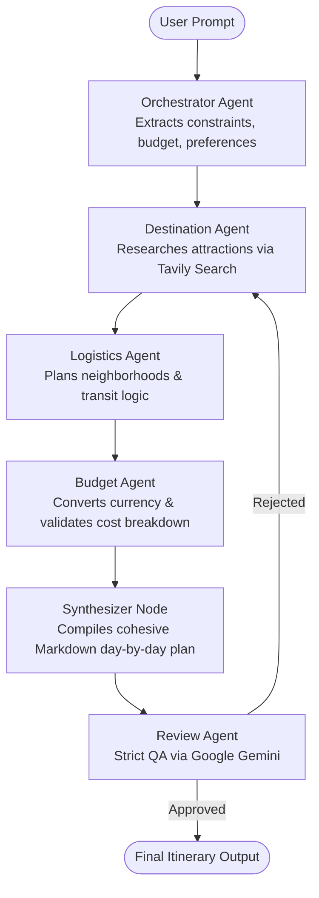

# AI Travel Planner (Multi-Agent System)

An autonomous multi-agent travel planning system built with **LangGraph**, **Groq** (LLaMA-3 / GPT-OSS), and **Google Gemini**, complete with a real-time streaming dark-mode Web UI and interactive CLI.

---

## 🏗️ Architecture & Multi-Agent Flow

The system orchestrates 5 specialized agents and a synthesis node sequentially to plan trips within real-world constraints while avoiding API rate limits:



- **Orchestrator Agent**: Parses natural language requests into structured constraints (destination, duration, budget, preferences, avoidances).
- **Destination Research Agent**: Autonomous ReAct agent with real-time web search ([Tavily](https://tavily.com)) to find curated venues matching preferences and avoiding dislikes.
- **Logistics Agent**: Analyzes geographic proximity and recommends transit strategies and optimal base neighborhoods.
- **Budget Agent**: Live exchange rate conversion (USD to AED and other currencies) with categorized daily spend estimates.
- **Synthesizer**: Consolidates all agent recommendations into an elegant, formatted daily travel guide.
- **Quality Assurance Review Agent**: Evaluates the synthesized draft using Gemini with structured output validation (`is_approved`, `feedback`). Triggers an autonomous revision loop if constraints are violated.

---

## 🚀 Quick Start (Running Locally)

### 1. Prerequisites
- Python 3.10+
- Valid API keys:
  - **GROQ_API_KEY**: [Groq Console](https://console.groq.com/keys)
  - **TAVILY_API_KEY**: [Tavily AI Search](https://tavily.com/)
  - **GEMINI_API_KEY**: [Google AI Studio](https://aistudio.google.com/)

### 2. Activate Virtual Environment
Open PowerShell or CMD in the project folder:
```powershell
.\venv\Scripts\activate
```

*(If setting up fresh without an existing `venv`:)*
```powershell
python -m venv venv
.\venv\Scripts\activate
pip install -r requirements.txt
```

### 3. Configure Environment Variables
Ensure `.env` exists in the project root with your keys:
```env
GROQ_API_KEY=your_groq_api_key_here
TAVILY_API_KEY=your_tavily_api_key_here
GEMINI_API_KEY=your_gemini_api_key_here
```

### 4. Run the Web Application
Launch the server with the convenience runner:
```powershell
python run.py
```
This automatically starts the FastAPI backend and opens the interactive Web UI in your default browser at:
👉 **[http://localhost:8000](http://localhost:8000)**

*(Alternatively, run using Uvicorn directly:)*
```powershell
python -m src.api.server
```

### 5. Run via Command Line (CLI)
You can also generate plans directly from the terminal:
```powershell
python main.py --prompt "Plan a 5-day trip to Dubai. $3,000 budget. Love food and shopping, hate crowds."
```
The resulting plan will be displayed in the terminal and saved to `output.md`.

---

## 📁 Project Structure

```text
├── frontend/
│   └── index.html          # Modern dark-mode streaming web UI
├── src/
│   ├── agents/
│   │   ├── orchestrator.py # Request parsing & constraint extraction
│   │   ├── workers.py      # Destination, Logistics, & Budget ReAct agents
│   │   └── review.py       # QA Reviewer with structured output
│   ├── api/
│   │   └── server.py       # FastAPI backend with NDJSON streaming (/plan)
│   ├── tools/
│   │   ├── currency.py     # Live exchange rate tool
│   │   ├── scraper.py      # Wikivoyage baseline scraper
│   │   └── search.py       # Real-time Tavily search tool
│   ├── config.py           # Model configurations (Groq & Gemini)
│   ├── graph.py            # LangGraph StateGraph definition
│   └── state.py            # TypedDict travel state definition
├── main.py                 # CLI execution script
├── run.py                  # One-click web server runner
├── requirements.txt        # Python package dependencies
└── .env                    # Environment variables (API keys)
```
