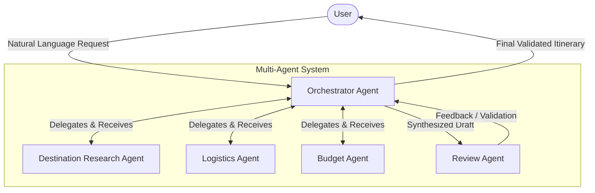
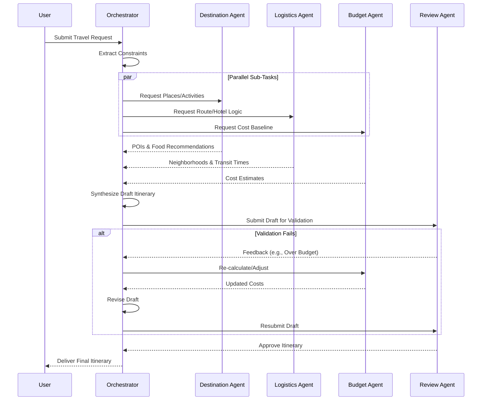

# Multi-Agent Travel Planner - Architecture Document

## 1. System Overview
The Multi-Agent Travel Planner is designed to take a natural language travel request and autonomously generate a comprehensive, personalized travel itinerary for Dubai. The system employs a multi-agent architecture where specialized AI agents handle specific domains (Destination Research, Logistics, Budget, Review) under the supervision of a central Orchestrator Agent.

## 2. High-Level Architecture

The system follows a hierarchical delegation pattern. The Orchestrator acts as the central hub, passing context and tasks to specialized worker agents, retrieving their outputs, and synthesizing the final result.

## 3. Agent Specifications

### 3.1 Orchestrator Agent
* **Responsibility**: Project management and synthesis.
* **Key Tasks**:
  * Parse natural language input to extract structured constraints (destination: Dubai, duration, budget, preferences, avoidances).
  * Route specific sub-tasks to the appropriate specialized agents (often in parallel).
  * Compile the responses from Destination, Logistics, and Budget agents into a cohesive draft itinerary.
  * Send the draft to the Review Agent for validation and handle any necessary revisions.
* **Tools/APIs**: LLM for NLP extraction, internal task queue management.

### 3.2 Destination Research Agent
* **Responsibility**: Curating points of interest, dining, and experiences.
* **Key Tasks**:
  * Map user preferences (e.g., "shopping, food") and avoidances (e.g., "crowds") to specific Dubai locations.
  * Retrieve current information on attractions (e.g., Burj Khalifa, Dubai Mall, Deira Souks).
* **Tools/APIs**: Web Search API (Tavily, Google Custom Search), Places API (Google Maps/Yelp).

### 3.3 Logistics Agent
* **Responsibility**: Optimizing travel routes and accommodation locations.
* **Key Tasks**:
  * Recommend optimal neighborhoods to stay based on the curated attractions.
  * Calculate realistic transit times (Metro, Taxi, walking) between daily points of interest to minimize backtracking.
  * Structure the days chronologically.
* **Tools/APIs**: Maps Routing API, Transit APIs.

### 3.4 Budget Agent
* **Responsibility**: Financial tracking and cost optimization.
* **Key Tasks**:
  * Estimate costs for accommodations, transit, food, and activities.
  * Monitor the cumulative cost against the user's hard limit (e.g., $3,000).
  * Suggest cost-saving alternatives if the draft plan exceeds the budget.
* **Tools/APIs**: Currency Exchange API, typical cost heuristic databases.

### 3.5 Review Agent
* **Responsibility**: Quality assurance and constraint validation.
* **Key Tasks**:
  * Evaluate the final draft itinerary against the initial user prompt.
  * Ensure logical consistency (e.g., no overlapping activities, travel time accounted for).
  * Provide a pass/fail status to the Orchestrator with specific revision notes if necessary.
* **Tools/APIs**: LLM with strict evaluation prompts.

## 4. Interaction Sequence

## 5. Suggested Technology Stack
* **Framework**: [LangGraph](https://python.langchain.com/v0.1/docs/langgraph/) or [AutoGen](https://microsoft.github.io/autogen/) to handle state, loops, and parallel agent execution.
* **LLM**: Large Language Models for complex reasoning tasks (Orchestrator, Review) and specialized tasks.
* **Tools Integration**: Framework-specific Tool calling for API integrations.
* **Language**: Python or TypeScript.

## 6. Implementation Phases
1. **Phase 1: Mocked Agents**: Build the system using hardcoded data outputs for the specialized agents to test the Orchestrator's routing and synthesis logic.
2. **Phase 2: Tool Integration**: Connect real APIs (Google Maps, Search) to the Destination and Logistics agents.
3. **Phase 3: Validation Loop**: Implement the Review agent and the feedback loop allowing the Orchestrator to revise the plan autonomously.
